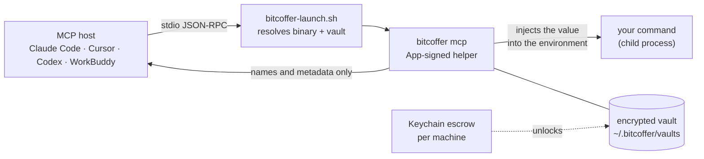

# Bitcoffer MCP server

**English** | [简体中文](README.zh.md)

[](LICENSE)
[](#install)
[](https://modelcontextprotocol.io)
[](https://github.com/cygnusyang/bitcoffer-plugins/releases)

**Give your coding agent a password without ever showing it the password.**

Bitcoffer keeps your passwords, API keys and tokens in an encrypted vault on your Mac. This repository is the **MCP server** that wires that vault into Claude Code, Cursor, Codex, WorkBuddy or any MCP host — the agent asks for a secret *by name*, and the value goes straight into the environment of the command it runs. It never enters the model context, a log file, or shell history.

> This repository contains **only** the MCP launcher, shared skills and host paste packs. It contains **no application source code**. The Bitcoffer app itself is proprietary — download it from <https://ai.cygnusyang.top/bitcoffer/>.

## The difference in one table

| | The usual way | With Bitcoffer |
| --- | --- | --- |
| Where the secret lives | `.env` file, shell history, a pasted chat message | encrypted vault on disk |
| How the agent gets it | reads the value into its context | value injected into a subprocess's environment |
| What the model actually sees | the password | a secret **name** |
| Cost of a leak | rotate everything, audit every log | nothing to rotate |
| Network exposure | whatever the config sends upstream | none — stdio only, no listener |

## How it works



The launcher resolves the App-signed binary and the local vault at connect time, so no per-user paths or vault UUIDs go into your config.

## What it does

The server exposes **4 tools** over MCP:

| Tool | Purpose |
| --- | --- |
| `list_secret_names` | List the names of stored secrets (no values) |
| `list_secrets` | List secret names + metadata (no values) |
| `get_secret_metadata` | Read one secret's metadata, including the stored login username (no values) |
| `run_with_secret` | Run a command with one or more secret values injected into its environment |

Values are **never returned** by any tool. A secret reaches a subprocess only through its environment, and only for a command you explicitly asked to run.

## Install

**1. Install the Bitcoffer app** (macOS):

```bash
brew install --cask cygnusyang/bitcoffer/bitcoffer
```

Or download the DMG from <https://ai.cygnusyang.top/bitcoffer/>. Recent Homebrew versions may require `brew trust cygnusyang/bitcoffer` first.

**2. Unlock once, and enable the escrow.** Open the app, unlock or create a vault, then go to **Settings → MCP / Agent collaboration** and enable **MCP unlock escrow**. Without it the MCP server cannot unlock the vault in the background. This is per machine and per user — redo it on every new Mac.

**3. Fetch the launcher:**

```bash
mkdir -p ~/.bitcoffer
curl -fsSL https://raw.githubusercontent.com/cygnusyang/bitcoffer-plugins/main/scripts/bitcoffer-launch.sh \
  -o ~/.bitcoffer/bitcoffer-launch.sh
chmod +x ~/.bitcoffer/bitcoffer-launch.sh
```

> Pin to a tag instead of `main` if you want a stable shape: replace `main` with `v0.1.0` in the URL.

## Quickstart

Register with Claude Code:

```bash
claude mcp add --scope user bitcoffer -- ~/.bitcoffer/bitcoffer-launch.sh
```

Or add it to any MCP client's config (`command` = the launcher, `args` empty):

```json
{
  "mcpServers": {
    "bitcoffer": {
      "command": "/Users/you/.bitcoffer/bitcoffer-launch.sh"
    }
  }
}
```

Verify:

```bash
claude mcp list
# expect: bitcoffer Connected; 4 tools
```

Per-host paste packs (Claude Code, Cursor, Codex, WorkBuddy) and a universal `tools/list` probe that works without any host live in [`docs/agents/`](docs/agents/).

## Use it well — and the one thing that ruins it

Ask for a secret by name and inject it. Never print it:

```
run_with_secret {
  secret: "github-token",
  cmd: "gh",
  args: ["auth", "status"],
  env_name: "GH_TOKEN"
}
```

The child process reads `$GH_TOKEN` from its environment and prints a *result*. The moment a wrapper does `echo $GH_TOKEN`, the value is in the context and the whole model is defeated. See [`skills/bitcoffer-credentials`](skills/bitcoffer-credentials/SKILL.md) for the full workflow and the anti-patterns.

## Security model

- **Local and offline.** The vault is an encrypted file on disk. There is no cloud account and no telemetry; secrets are never uploaded.
- **Values are never returned.** Names and metadata only. `run_with_secret` injects the value into the environment of a command you explicitly asked to run.
- **Transport is local.** MCP over stdio; no TCP/UDP listener, no outbound connection.
- **App-signed trust anchor.** The launcher runs the `bitcoffer` helper bundled inside the signed app so the Keychain escrow resolves. A bare `bitcoffer` on `PATH` may fail on signing / Keychain context.

The full invariants, the threat model (it protects against accidental disclosure, not against malware already running as you), and the private reporting channel are in [SECURITY.md](SECURITY.md).

## What's inside

| Path | Purpose |
| --- | --- |
| `scripts/bitcoffer-launch.sh` | MCP server entry — auto-detects the App-signed binary + vault, then `exec bitcoffer mcp` |
| `scripts/bitcoffer-login` | Browser-login driver (password via env from `run_with_secret`, never argv/stdout) |
| `skills/` | Host-agnostic skills: `bitcoffer-credentials` (use secrets) and `bitcoffer-setup` (diagnose/repair) |
| `docs/agents/` | Per-host paste packs and MCP config snippets |
| `SECURITY.md` · `CONTRIBUTING.md` · `CHANGELOG.md` | Policy, contribution rules, version history |

## Languages

Every document ships in English and Simplified Chinese; English is the source of truth and the file an agent loads, the Chinese file is a full parallel translation.

<details>
<summary>Language index (12 pairs)</summary>

| English | 简体中文 |
| --- | --- |
| [README.md](README.md) | [README.zh.md](README.zh.md) |
| [SECURITY.md](SECURITY.md) | [SECURITY.zh.md](SECURITY.zh.md) |
| [CONTRIBUTING.md](CONTRIBUTING.md) | [CONTRIBUTING.zh.md](CONTRIBUTING.zh.md) |
| [CHANGELOG.md](CHANGELOG.md) | [CHANGELOG.zh.md](CHANGELOG.zh.md) |
| [docs/agents/README.md](docs/agents/README.md) | [docs/agents/README.zh.md](docs/agents/README.zh.md) |
| [docs/agents/claude-code.md](docs/agents/claude-code.md) | [claude-code.zh.md](docs/agents/claude-code.zh.md) |
| [docs/agents/codex.md](docs/agents/codex.md) | [codex.zh.md](docs/agents/codex.zh.md) |
| [docs/agents/cursor.md](docs/agents/cursor.md) | [cursor.zh.md](docs/agents/cursor.zh.md) |
| [docs/agents/workbuddy.md](docs/agents/workbuddy.md) | [workbuddy.zh.md](docs/agents/workbuddy.zh.md) |
| [docs/agents/rules.md](docs/agents/rules.md) | [rules.zh.md](docs/agents/rules.zh.md) |
| [skills/bitcoffer-credentials/SKILL.md](skills/bitcoffer-credentials/SKILL.md) | [SKILL.zh.md](skills/bitcoffer-credentials/SKILL.zh.md) |
| [skills/bitcoffer-setup/SKILL.md](skills/bitcoffer-setup/SKILL.md) | [SKILL.zh.md](skills/bitcoffer-setup/SKILL.zh.md) |

</details>

## Status

Pre-1.0. Paths and skill wording may change between minor versions — pin to a tag if you depend on a specific shape. See [CHANGELOG.md](CHANGELOG.md).

## License

[MIT](LICENSE). Use it, modify it, redistribute it, sell it — keep the copyright notice and the licence text. The licence covers the skills, scripts and docs in this repository only; the Bitcoffer application remains proprietary and is governed by the terms you accept when you install it.
