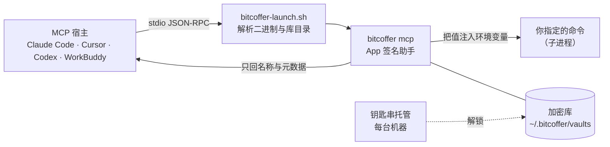

# Bitcoffer MCP server

[English](README.md) | **简体中文**

[](LICENSE)
[](#安装)
[](https://modelcontextprotocol.io)
[](https://github.com/cygnusyang/bitcoffer-plugins/releases)

**把密码交给编码 agent，但不让它看见密码。**

Bitcoffer 把密码、API key 与 token 保存在 Mac 上的加密库里。本仓库是 **MCP server**：把这套库接到 Claude Code、Cursor、Codex、WorkBuddy 或任何 MCP 宿主上——agent 只按**名字**取密钥，值直接进入它要执行的那条命令的环境变量，不进入模型上下文，不进入日志，不进入 shell 历史。

> 本仓库**只有** MCP launcher、共用 skill 和宿主配置包，**不含应用源码**。Bitcoffer 应用本体为专有软件，下载地址 <https://ai.cygnusyang.top/bitcoffer/>。

## 一张表说清差别

| | 常见做法 | 用 Bitcoffer |
| --- | --- | --- |
| 密钥存在哪 | `.env` 文件、shell 历史、粘在对话里的文本 | 磁盘上的加密库 |
| agent 怎么拿到 | 把值读进自己的上下文 | 值注入子进程环境变量 |
| 模型实际看到什么 | 密码本身 | 密钥的**名字** |
| 泄露的代价 | 全部轮换、逐份日志排查 | 没有东西需要轮换 |
| 网络暴露面 | 取决于配置往上游发了什么 | 无——只走 stdio，不监听端口 |

## 工作方式



launcher 在连接时解析 App 签名的二进制与本地库目录，所以配置里不必写任何用户路径或库 UUID。

## 提供什么

服务通过 MCP 暴露 **4 个工具**：

| 工具 | 作用 |
| --- | --- |
| `list_secret_names` | 列出所有密钥名称（不含值） |
| `list_secrets` | 列出名称 + 元数据（不含值） |
| `get_secret_metadata` | 读单个密钥的元数据，含已保存的登录用户名（不含值） |
| `run_with_secret` | 把一到多个密钥值注入环境变量后执行命令 |

任何工具都**不会返回值**。密钥只通过环境变量到达子进程，且只在你显式要求执行的命令里。

## 安装

**1. 安装 Bitcoffer 应用**（macOS）：

```bash
brew install --cask cygnusyang/bitcoffer/bitcoffer
```

或从 <https://ai.cygnusyang.top/bitcoffer/> 下载 DMG。较新的 Homebrew 可能需要先执行 `brew trust cygnusyang/bitcoffer`。

**2. 解锁一次并开启托管。** 打开应用，解锁或新建库，然后进 **设置 → MCP / Agent 协作**，开启 **MCP 解锁托管**。不开这个，MCP server 无法在后台解锁库。托管按机器、按用户生效——换新 Mac 要重做一次。

**3. 取 launcher：**

```bash
mkdir -p ~/.bitcoffer
curl -fsSL https://raw.githubusercontent.com/cygnusyang/bitcoffer-plugins/main/scripts/bitcoffer-launch.sh \
  -o ~/.bitcoffer/bitcoffer-launch.sh
chmod +x ~/.bitcoffer/bitcoffer-launch.sh
```

> 想要稳定形态就固定 tag：把 URL 里的 `main` 换成 `v0.1.0`。

## 快速接入

注册到 Claude Code：

```bash
claude mcp add --scope user bitcoffer -- ~/.bitcoffer/bitcoffer-launch.sh
```

或写进任意 MCP 客户端配置（`command` 指向 launcher，`args` 留空）：

```json
{
  "mcpServers": {
    "bitcoffer": {
      "command": "/Users/you/.bitcoffer/bitcoffer-launch.sh"
    }
  }
}
```

验证：

```bash
claude mcp list
# 期望：bitcoffer Connected；4 tools
```

各宿主的即贴配置包（Claude Code、Cursor、Codex、WorkBuddy）和一个不依赖宿主的通用 `tools/list` 探针在 [`docs/agents/`](docs/agents/README.zh.md)。

## 用对它——以及唯一会毁掉它的做法

按名字取密钥并注入，绝不打印：

```
run_with_secret {
  secret: "github-token",
  cmd: "gh",
  args: ["auth", "status"],
  env_name: "GH_TOKEN"
}
```

子进程从环境变量读 `$GH_TOKEN`，只打印**结果**。一旦包装脚本 `echo $GH_TOKEN`，值就进了上下文，整套模型作废。完整流程与反面清单见 [`skills/bitcoffer-credentials`](skills/bitcoffer-credentials/SKILL.zh.md)。

## 安全模型

- **本地、离线。** 库是磁盘上的加密文件，没有云端账号、没有遥测，密钥从不上传。
- **永不返回值。** 只有名称与元数据。`run_with_secret` 把值注入到你显式要求执行的命令的环境里。
- **传输在本地。** MCP over stdio，不开 TCP/UDP 监听，不发起对外连接。
- **App 签名作为信任锚。** launcher 运行签名 App 内置的 `bitcoffer` 助手，钥匙串托管才解得开。`PATH` 上的裸 `bitcoffer` 可能因签名/钥匙串上下文失败。

完整不变量、威胁模型（它防意外泄露，不防已以你的权限运行的恶意代码）与私密报告渠道见 [SECURITY.zh.md](SECURITY.zh.md)。

## 目录

| 路径 | 作用 |
| --- | --- |
| `scripts/bitcoffer-launch.sh` | MCP 入口——自动识别 App 签名二进制与库目录，然后 `exec bitcoffer mcp` |
| `scripts/bitcoffer-login` | 浏览器登录驱动（密码经 `run_with_secret` 走环境变量，不经 argv/stdout） |
| `skills/` | 与宿主无关的 skill：`bitcoffer-credentials`（用密钥）、`bitcoffer-setup`（诊断修复） |
| `docs/agents/` | 各宿主即贴配置包与 MCP 配置片段 |
| `SECURITY.md` · `CONTRIBUTING.md` · `CHANGELOG.md` | 安全策略、贡献规则、版本历史 |

## 语言

每篇文档都有英文与简体中文两版。英文是原文，也是 agent 加载的那份；中文是完整对照译文，不是摘要。

<details>
<summary>语言索引（12 对）</summary>

| 简体中文 | English |
| --- | --- |
| [README.zh.md](README.zh.md) | [README.md](README.md) |
| [SECURITY.zh.md](SECURITY.zh.md) | [SECURITY.md](SECURITY.md) |
| [CONTRIBUTING.zh.md](CONTRIBUTING.zh.md) | [CONTRIBUTING.md](CONTRIBUTING.md) |
| [CHANGELOG.zh.md](CHANGELOG.zh.md) | [CHANGELOG.md](CHANGELOG.md) |
| [docs/agents/README.zh.md](docs/agents/README.zh.md) | [docs/agents/README.md](docs/agents/README.md) |
| [claude-code.zh.md](docs/agents/claude-code.zh.md) | [docs/agents/claude-code.md](docs/agents/claude-code.md) |
| [codex.zh.md](docs/agents/codex.zh.md) | [docs/agents/codex.md](docs/agents/codex.md) |
| [cursor.zh.md](docs/agents/cursor.zh.md) | [docs/agents/cursor.md](docs/agents/cursor.md) |
| [workbuddy.zh.md](docs/agents/workbuddy.zh.md) | [docs/agents/workbuddy.md](docs/agents/workbuddy.md) |
| [rules.zh.md](docs/agents/rules.zh.md) | [docs/agents/rules.md](docs/agents/rules.md) |
| [SKILL.zh.md](skills/bitcoffer-credentials/SKILL.zh.md) | [skills/bitcoffer-credentials/SKILL.md](skills/bitcoffer-credentials/SKILL.md) |
| [SKILL.zh.md](skills/bitcoffer-setup/SKILL.zh.md) | [skills/bitcoffer-setup/SKILL.md](skills/bitcoffer-setup/SKILL.md) |

</details>

## 状态

1.0 之前。路径与 skill 措辞可能在小版本之间变化——依赖具体形态请固定 tag。见 [CHANGELOG.zh.md](CHANGELOG.zh.md)。

## 授权

[MIT](LICENSE)。可用、可改、可再分发、可销售，条件是保留版权声明与协议正文。协议只覆盖本仓库的 skill、脚本与文档；Bitcoffer 应用本体仍为专有软件，适用你安装时接受的条款。
